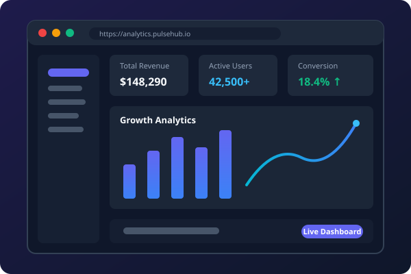

# Modern Developer Portfolio Website

A high-performance, fully responsive, and modern personal portfolio website built with **HTML5**, **Bootstrap 5.3**, **Custom CSS**, and **Vanilla JavaScript**.



---

## ✨ Features

- 🌓 **Dark & Light Mode Toggle**: One-click theme switcher with automatic preference detection and `localStorage` persistence.
- ⚡ **Dynamic Typewriter Effect**: Smooth multi-role animated headline in the hero section.
- 🎨 **Glassmorphism & Ambient Glows**: Modern backdrop blur cards, ambient gradient lighting, and glowing accent borders.
- 🔍 **Interactive Project Showcase**:
  - Filterable portfolio categories (*All*, *Full Stack*, *AI & ML*, *FinTech*, *Mobile & API*, *DevOps*).
  - Quick View popup modals featuring deep project overviews, feature breakdowns, tech badges, and repository/live demo links.
- 📊 **Animated Stats Counter**: Scroll-triggered numeric counters that dynamically increment on viewport entry.
- 📈 **Animated Skill Bars**: Progress indicators animated using the `IntersectionObserver` API.
- ⏳ **Experience & Education Timeline**: Dual vertical timeline for career history and academic credentials.
- ⭐ **Testimonials Section**: Colleague & client recommendations with 5-star ratings.
- 📬 **Interactive Contact Form**:
  - Client-side form validation (`was-validated`).
  - Animated button loading spinner.
  - Interactive Bootstrap toast notification on submission.
- 📱 **100% Responsive**: Tailored for mobile phones, tablets, laptops, and ultra-wide screens.
- 🚀 **Zero Build Step Required**: Open `index.html` directly in any web browser or serve via any static file server.

---

## 📁 Project Structure

```text
d:\portfolio/
│
├── index.html                 # Main website markup & semantic structure
├── README.md                  # Project documentation & guide
│
├── css/
│   └── style.css              # Custom CSS variables, glassmorphism, animations
│
├── js/
│   └── main.js                # Theme switcher, typewriter, filters, modals, form toast
│
└── assets/
    └── img/
        ├── favicon.svg        # Modern vector favicon
        ├── hero-avatar.svg    # Hero illustration with floating tech badges
        ├── project-1.svg      # PulseHub Analytics Dashboard mockup
        ├── project-2.svg      # Nexus AI Studio mockup
        ├── project-3.svg      # FinPay Global Wallet mockup
        ├── project-4.svg      # AuraFit Mobile Tracker mockup
        ├── project-5.svg      # KubePulse Cluster Monitor mockup
        ├── project-6.svg      # TaskFlow Kanban Hub mockup
        ├── testimonial-1.svg  # Client avatar 1
        ├── testimonial-2.svg  # Client avatar 2
        └── testimonial-3.svg  # Client avatar 3
```

---

## 🚀 How to Run Locally

### Option 1: Direct Browser Launch
Simply double-click [`index.html`](file:///d:/portfolio/index.html) or right-click and open with your preferred browser (Chrome, Edge, Firefox, Brave, Safari).

### Option 2: Using Python HTTP Server
Run the following in PowerShell / Terminal inside `d:\portfolio`:

```bash
python -m http.server 8000
```
Then visit: [http://localhost:8000](http://localhost:8000)

---

## 🛠️ How to Customize

1. **Personal Information**:
   - Open [`index.html`](file:///d:/portfolio/index.html) and update your name, title, bio, email, social links, and experience.
2. **Typewriter Roles**:
   - In [`js/main.js`](file:///d:/portfolio/js/main.js), locate the `roles` array in `initTypewriter()` to add your custom titles.
3. **Projects & Modals**:
   - In [`js/main.js`](file:///d:/portfolio/js/main.js), update the `projectData` object with your actual project links, descriptions, and screenshots.
4. **Color Theme & Accents**:
   - In [`css/style.css`](file:///d:/portfolio/css/style.css), edit the `--primary`, `--secondary`, and `--accent` CSS variables in the `:root` block to match your personal brand palette.

---

## 🌐 Free Deployment Options

- **GitHub Pages**: Push this directory to a repository named `username.github.io` and enable GitHub Pages in settings.
- **Vercel**: Run `vercel` or connect your GitHub repository for instant global CDN deployment.
- **Netlify**: Drag and drop the `portfolio` folder directly into the Netlify dashboard.
